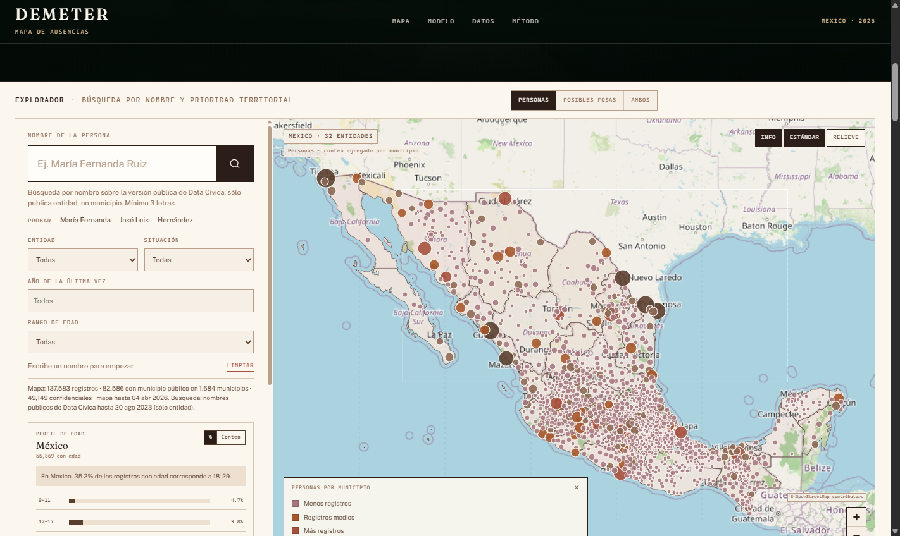
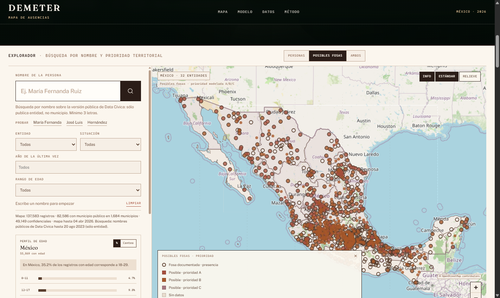

# Demeter

**Mapa público de ausencias en México y priorización transparente de búsqueda.**

[](https://github.com/AndyG4/Demeter/actions/workflows/ci.yml)
[](LICENSE)

Repositorio: [github.com/AndyG4/Demeter](https://github.com/AndyG4/Demeter)

Demeter cruza registros públicos, geometría municipal y un modelo auditable para responder dos preguntas distintas:

1. **¿Dónde se registraron desapariciones?** Mapa de 137,583 personas únicas anonimizadas y consulta de los registros de cada municipio.
2. **¿Dónde conviene buscar primero?** Ordenamiento territorial a partir de fosas documentadas y variables públicas.

No es una herramienta de denuncia, no reemplaza a la Comisión Nacional de Búsqueda y no promete encontrar una fosa en una coordenada. La búsqueda por nombre requiere un CSV autorizado con nombres; la base pública abierta es anónima.


## Estado del proyecto

| Pieza | Estado |
|---|---|
| Backend Spring Boot 3.4 / Java 21 | Funcional |
| Datos reales anonimizados | **137,583 personas únicas** (base abril 2026) |
| Mapa de personas por municipio | Funcional |
| Fosas documentadas y posibles fosas | Funcional, separadas visualmente |
| Mapa de calles (OpenStreetMap) | Opcional, activable |
| Búsqueda por nombre | Funcional con nombres públicos (sólo entidad); CSV para municipio |
| Modelo de priorización con validación espacial | Funcional |
| Documentación de datos, seguridad, ética y modelo | Incluida |

> **Datos reales, sin nombres en el mapa.** El mapa combina la base de 2025 (**133,887** personas) con **3,696 hechos nuevos de abril de 2026**: **137,583 personas únicas**. No incluye nombres. La búsqueda por nombre usa la **versión pública de nombres de Data Cívica** (78,684 registros), que sólo publica entidad. Para municipio con nombre hace falta un CSV autorizado.

## Métricas del modelo publicado

Objetivo: presencia documentada de fosas por municipio (2006-2024). Validación espacial de 8 folds: se dejan entidades completas fuera del entrenamiento.

| Modelo | AUC | AP | Precisión @10% | Lift @10% |
|---|---:|---:|---:|---:|
| M0 · Persistencia histórica | 0.823 | 0.749 | 84.9% | 2.52× |
| M1 · KDE espacial | 0.562 | 0.457 | 49.4% | 1.39× |
| M2 · Random Forest | 0.816 | 0.745 | 85.9% | 2.62× |
| **M3 · Persistencia + historia municipal** (publicado) | **0.858** | **0.804** | **92.5%** | **2.82×** |

M3 es un Random Forest regularizado (profundidad 5, hoja mínima 60, 160 árboles) que añade la historia municipal de desapariciones **2015-2024**. Los datos de **2025-2026 quedan fuera del entrenamiento**, de la selección de hiperparámetros y de la comparación; se reservan para una validación temporal cuando exista un panel completo. M3 supera el AP del mejor baseline en **7.3% relativo** y también reduce el Brier respecto a M2. Sus probabilidades se calibran con regresión isotónica out-of-fold: Brier **0.130**. En el diagnóstico de sobreajuste, la ablación con las mismas 9 variables y la misma regularización da AP 0.731 frente a 0.790 de M3 (IC 95% +0.043 a +0.075); la permutación de la historia municipal baja el AP a 0.736 (p=0.05). Sigue sin ser validación temporal. Ver [`docs/MODELOS_ML.md`](docs/MODELOS_ML.md).

Backtest estatal retrospectivo 2015-2016 (13 entidades con serie completa): MAE 11.7 fosas, RMSE 23.9, Spearman 0.74.

## Inicio rápido

Requisitos: Java 21, Maven 3.9+.

```bash
mvn -o -DskipTests package
java -jar target/demeter.jar
```

Abre `http://localhost:8080`.

Para desarrollo con recarga de recursos:

```bash
mvn -o spring-boot:run
```

Pruebas:

```bash
mvn -o test
```

> El proyecto está preparado para compilar sin red si las dependencias ya están en `~/.m2`. Si no, usa `mvn package` con conexión.

## Despliegue

- Vercel con Container Runtime: [`docs/DESPLIEGUE_VERCEL.md`](docs/DESPLIEGUE_VERCEL.md)
- Imagen: `Dockerfile.vercel`
- Configuración: `vercel.json`
- El servidor escucha en `0.0.0.0` y en `PORT`.

Vercel ejecuta Spring Boot dentro de un contenedor OCI. Es válido para una demo; para disponibilidad continua conviene Render, Fly.io o Cloud Run.

## Cómo se usa

1. Escribe al menos 3 letras de un nombre o apellido. La búsqueda usa la versión pública de nombres de Data Cívica y tolera mayúsculas, acentos y errores de una letra. La ubicación es **aproximada a la entidad**, porque esa fuente no publica municipio.
2. Haz clic en una coincidencia: el mapa borra los demás puntos de búsqueda, deja **sólo el punto de esa persona** y vuela a su última ubicación aproximada.
3. Haz clic en un círculo municipal en el mapa. El mapa hace zoom y el panel muestra el resumen y hasta 50 **registros anonimizados** de ese municipio: sexo, edad, fecha, estatus y autoridad que reportó. No hay nombres en esa capa.
4. Cambia el modo del mapa:
   - **Personas**: un círculo por municipio, con tamaño y color según el número de registros reales. Al seleccionar una entidad, sólo quedan sus puntos; los demás se ocultan hasta limpiar el filtro.
   - **Posibles fosas**: separa **fosas documentadas** (punto oscuro, presencia municipal reportada) de **posibles fosas** (punto claro, prioridad modelada).
   - **Ambos**: personas y fosas en la misma vista.
5. Cambia el mapa base entre **Estándar** (OpenStreetMap) y **Relieve** (Esri Topo); ambos llegan a nivel de calle.
6. Elige un **rango de edad** para recolorear el mapa por la cantidad de personas de ese grupo. El perfil de edad del panel muestra los grupos con más registros. La tasa por 100 mil habitantes aparece en los tooltips y resúmenes.

La búsqueda por nombre no tiene municipio porque la fuente pública no lo publica. El mapa municipal sí lo tiene, pero es anónimo. Para unir nombre y municipio se necesita un CSV autorizado.

## Capturas






## Fondo cinematográfico

El **hero** tiene un bosque de oyamel generado con Canvas 2D: siluetas de árboles, niebla, haces de luz, polvo, un sendero vacío y **mariposas monarca** dibujadas con cuatro alas, venas y manchas blancas. No hay video, GIF ni imágenes externas.

- Sólo se monta en el hero; el mapa y las tablas quedan limpios.
- Se pausa cuando el hero o la pestaña no están visibles.
- Respeta `prefers-reduced-motion`.
- Ajusta densidad y DPR en móvil.
- Responde al scroll y al puntero con parallax suave.

### Actualización

El encabezado refresca **corte y registros cargados** cada minuto. Si cambia la versión del dataset, también se recargan los agregados municipales, la geometría y las predicciones; no hay que recargar la página. La búsqueda pagina de 25 en 25 y permite **cargar 50 más** o **ver todas** las coincidencias.

## Datos reales

La instancia incluye una **base pública anonimizada** de Data Cívica:

- **137,583 personas únicas**: **133,887** de la base 2025 + **3,696** hechos nuevos de abril de 2026.
- **49,149 confidenciales** de la base 2025: sus campos sensibles aparecen como “Confidencial” y se muestran sin fecha o municipio cuando corresponde.
- **82,586** personas con municipio identificable; **54,997** sin municipio público.
- **78,684** nombres en la búsqueda; **55,869** personas del mapa con edad calculable. El perfil de edad es un **conteo absoluto**, no una tasa ajustada por la población de cada grupo.
- Tasa por 100 mil habitantes calculada con población municipal aproximada; no es una probabilidad individual.
- Fuente: base 2025 de Data Cívica + base filtrada de abril 2026, ambas anonimizadas; nombres públicos de Data Cívica. Corte del mapa: **30 de abril de 2026**; último hecho: **4 de abril de 2026**.

La base municipal **no incluye nombres**. Es una decisión de privacidad: la versión publicada está anonimizada.

Para la **búsqueda por nombre** se usa la versión pública de nombres de Data Cívica, incluida en `data/registros_nombres.csv` y copiada a la imagen de Vercel. Son **78,684 registros** con nombre, edad, sexo, fecha y entidad; **no incluyen municipio**. El buscador muestra `Aproximada a la entidad` y `Sin municipio público`. La fuente permite solicitar retiro de un nombre.

Para **nombre + municipio** hace falta un CSV autorizado. Coloca `registros.csv` y `manifest.json` en `data/` con `"synthetic": false`; el importador acepta `nombres` + apellidos, `fecha_desaparicion`, `municipio` + `entidad`, `situacion` y coordenadas opcionales. Cuando el conjunto tiene nombres y municipio, el buscador y el mapa municipal se enriquecen.

```json
{
  "version": "2026-11-convenio",
  "cutoff": "2026-10-31",
  "source": "Convenio CNB / SESNSP",
  "synthetic": false,
  "recordsFile": "registros.csv"
}
```

Guía completa, esquema y texto base para una solicitud de transparencia: [`docs/DATOS_REALES.md`](docs/DATOS_REALES.md).

### Qué no incluye

- **El mapa sí incluye 2026:** el último hecho es del **4 de abril de 2026** y el corte es del **30 de abril de 2026**. La capa pública de nombres sigue hasta **20 de agosto de 2023**; no hay nombres de 2026.
- Nombres en la capa municipal anónima.
- Municipio en la capa pública de nombres.
- Fotografías.
- Causa o autoría de la desaparición.
- Coordenadas exactas de personas o fosas.
- Datos de personas localizadas: el dataset abierto contiene casos que siguen desaparecidos o no localizados.


## Arquitectura en una hoja

```
src/main/java/mx/rastro
├── shared
│   ├── config        propiedades con límites seguros
│   ├── error         errores sin trazas internas
│   ├── ratelimit     token bucket por IP
│   ├── text          normalización, Damerau-Levenshtein, fonética
│   ├── util          CSV acotado, Haversine
│   └── web           cabeceras de seguridad, request id
└── features
    ├── catalog       entidades y 2,469 municipios
    ├── dataset       carga, validación, versión y recarga
    ├── records       modelo mínimo y generador sintético
    ├── search        índice, ranking y API
    ├── geo           GeoJSON enriquecido
    └── predictions   features, Random Forest, KDE, K-means, grafo
```

- **Package by feature**: cada capacidad vive con su controlador, servicio y modelo.
- **Singleton**: `SearchIndex`, `DatasetService`, `PredictionService`, `TokenBucketRateLimiter` son beans únicos con instantáneas inmutables.
- **Factory**: `ModelFactory` centraliza los hiperparámetros de los bosques de validación y producción.
- **Frontend ES6 + atomic design**: `atoms/`, `molecules/`, `organisms/`, `pages/`; sin framework y sin build step.
- **GSAP** para la entrada del hero, los contadores y la aparición de resultados, respetando `prefers-reduced-motion`.

Detalle completo: [`docs/ARQUITECTURA.md`](docs/ARQUITECTURA.md).

## Por qué no hay base de datos

El conjunto es de tamaño acotado (137,583 personas únicas), se lee completo al iniciar y se sirve desde un índice en memoria. Esto elimina SQL injection, reduce la superficie de ataque y permite reconstruir el índice completo cuando cambian los datos. El costo es que la instancia no escala horizontalmente sin compartir la instantánea; está documentado en la arquitectura.

## Datos

| Fuente | Uso | Cobertura |
|---|---|---|
| RNPDNO · base 2025 + abril 2026 (Data Cívica, anonimizada) | Personas, estatus, sexo, edad, fecha y municipio | 137,583 personas únicas · corte 2026-04-30 |
| Data Cívica · nombres públicos | Búsqueda por nombre, entidad | 78,684 registros · sólo entidad |
| RNPDNO (versión estadística) | Definiciones, contexto, criterios de estatus | Agregados; sin descarga masiva |
| A dónde van los Desaparecidos | Fosas por entidad y año | 2006-2016 · 1,957 fosas |
| Plataforma Ciudadana de Fosas | Presencia documentada por municipio | 2006-2024 · 788 municipios |
| INEGI / GeoNames | Límites, claves y población aproximada | 32 entidades · 2,469 municipios |
| Esri World Topo Map / OpenStreetMap | Relieve y estándar | Cobertura global |

**Licencias y límites:** la base municipal de abril 2026 es la versión **anonimizada** que publica Data Cívica; no incluye nombres y no declara una licencia de reutilización explícita. La versión de nombres de Data Cívica es pública, tampoco tiene una licencia de reutilización explícita y se incluye en la imagen pública para habilitar la búsqueda; incluye un mecanismo de retiro. La API de la Plataforma Ciudadana de Fosas no declara licencia explícita: se usa como etiqueta agregada de validación y para producción se debe solicitar autorización. El RNPDNO no ofrece descarga masiva y no se automatiza su captcha ni su puerta de términos. No se usan bases filtradas sin anonimizar; la base usada es la versión anonimizada publicada por Data Cívica. No se usan fichas personales de la SCJN. El mapa estándar usa OpenStreetMap con atribución; el relieve usa Esri Topo.

Detalle: [`docs/DATOS.md`](docs/DATOS.md) y auditoría en [`docs/investigacion/FUENTES_DATOS.md`](docs/investigacion/FUENTES_DATOS.md).

### Actualización automática

Coloca `registros.csv` y `manifest.json` en `./data`:

```json
{
  "version": "2026-11",
  "cutoff": "2026-10-31",
  "source": "Convenio de acceso a datos",
  "synthetic": false,
  "recordsFile": "registros.csv"
}
```

El servicio revisa cambios cada cinco minutos, valida el archivo, reconstruye el índice y vuelve a entrenar. No hay endpoint de escritura ni de subida de archivos.

Esquema mínimo de `registros.csv`:

```csv
id,folio,nombre,edad,sexo,fecha_visto,municipio_id,estatus,condicion,fuente,actualizado
R-0001,EXP-2026-001,María Fernanda Ruiz Salas,34,Mujer,2026-10-12,01001,DESAPARECIDA,,Convenio,2026-11-01
```

Los registros sin municipio válido, sin fecha o con nombre demasiado corto se descartan. El archivo se limita a 200,000 filas.

## Seguridad y privacidad

- CSP estricta sin terceros; todo el JS, CSS y fuentes se sirven desde el mismo origen.
- Límite por IP: 120 solicitudes/minuto; 30 búsquedas/minuto.
- Búsqueda mínima de 3 letras, máximo 25 resultados, sin listados masivos ni endpoint de descarga del padrón.
- Validación de entrada y límites de tamaño; errores sin trazas internas.
- Sin login, sin cookies de sesión, sin perfiles de usuario.
- Datos mínimos: no se guardan direcciones, teléfonos, documentos, fotografías ni datos de familiares.
- No se evaden captchas, controles de acceso ni términos de uso. No se ingieren bases filtradas.

Checklist de despliegue y riesgos residuales: [`docs/SEGURIDAD.md`](docs/SEGURIDAD.md).

## API

| Método | Ruta | Descripción |
|---|---|---|
| GET | `/api/v1/stats` | Conteos, corte, fuente y disponibilidad de nombres |
| GET | `/api/v1/search?q=...` | Búsqueda por nombre (nombres públicos, precisión estatal) |
| GET | `/api/v1/geo/estados` | GeoJSON estatal enriquecido |
| GET | `/api/v1/geo/municipios` | Conteos agregados por municipio, sin nombres |
| GET | `/api/v1/geo/municipios/{id}/registros` | Registros anonimizados de un municipio |
| GET | `/api/v1/predictions` | Prioridad municipal |
| GET | `/api/v1/models` | Reporte de validación e importancia |
| GET | `/api/v1/clusters` | Perfiles y comunidades |
| GET | `/api/v1/health` | Estado y versión del conjunto |

Referencia completa: [`docs/API.md`](docs/API.md).

## Límites

- **No predice la ubicación de una fosa.** Ordena municipios con evidencia histórica.
- **No infiere autoría ni motivo.** El registro público no permite identificar si una desaparición fue cometida por un cartel, una pareja o el Estado. Hacerlo sería estigmatizante y falsamente preciso.
- **La validación es retrospectiva y espacial.** No hay validación prospectiva ni año por municipio en los datos abiertos.
- **El registro oficial no es reproducible.** 38.5% de registros están confidencializados y las cifras cambian entre cortes. Un modelo entrenado con lo visible aprende también ese sesgo.
- **La capa municipal no incluye nombres.** Es anónima. La búsqueda por nombre usa otra fuente pública que sólo publica entidad; para nombre + municipio se requiere un CSV autorizado.
- **No se predicen causas, autoría ni motivación.** El dataset no contiene una variable causal confiable; inferirla estigmatizaría personas y territorios.
- **No se calcula probabilidad de localización.** La fuente abierta no contiene personas localizadas (0 registros con ese estatus); mostrar un porcentaje sería inventarlo.
- **No hay fotos.** La base pública no las incluye y cargar imágenes de víctimas exigiría consentimiento y una revisión de privacidad.

Marco ético: [`docs/ETICA.md`](docs/ETICA.md). Limitaciones técnicas y éticas del modelo: [`docs/MODELOS_ML.md`](docs/MODELOS_ML.md).

## Documentación

- [Arquitectura](docs/ARQUITECTURA.md)
- [Matemáticas del modelo](docs/MATEMATICAS.md)
- [Despliegue en Vercel](docs/DESPLIEGUE_VERCEL.md)
- [Seguridad](docs/SEGURIDAD.md)
- [Datos](docs/DATOS.md)
- [Modelos de ML](docs/MODELOS_ML.md)
- [Model card](docs/modelos/MODEL_CARD.md)
- [Ética](docs/ETICA.md)
- [Datos reales y solicitudes](docs/DATOS_REALES.md)
- [API](docs/API.md)
- [Auditoría de fuentes](docs/investigacion/FUENTES_DATOS.md)
- [Investigación de modelos](docs/investigacion/MODELOS_ML.md)
- [Guion de presentación](docs/PRESENTACION.md)

## Licencia y créditos

Código: MIT (`LICENSE`). Los datos conservan sus licencias y condiciones de origen; ver [`NOTICE`](NOTICE) y [`docs/DATOS.md`](docs/DATOS.md). La base municipal es la versión anonimizada publicada por Data Cívica. La capa de nombres de Data Cívica se incluye en la imagen pública para habilitar la búsqueda. Los registros sintéticos de demostración, si se activan, no representan personas reales.

Hecho para que la prioridad de búsqueda sea **discutible**: con datos, con métricas, con incertidumbre y con límites a la vista.


