# Demeter · guion de presentación

## ¿Está listo para presentarse?

**Sí para una demostración pública controlada. No todavía para un lanzamiento operativo.**

Lo que ya se puede mostrar:

- Mapa nacional con 137,583 registros anonimizados.
- Búsqueda por nombre con resultados paginados.
- Ficha individual sin coordenadas exactas.
- Capa de prioridad municipal.
- Modelo M3 con métricas, ablación y limitaciones explícitas.
- Fuentes, aviso legal y método.
- Diseño responsive.

Lo que debe decirse antes de una presentación pública:

- La base es una **versión pública anonimizada**, no el padrón completo.
- Los puntos son **prioridad municipal**, no fosas localizadas.
- El modelo **no predice fosas nuevas**; ordena municipios con evidencia histórica.
- La licencia de la Plataforma Ciudadana de Fosas no está declarada; falta autorización para producción.
- Las capturas de búsqueda contienen **nombres públicos**. Para difusión masiva deben enmascararse o presentarse con consentimiento.
- M4 está en sandbox: un solo estado y sin validación externa.

## Capturas

### 00 · Header

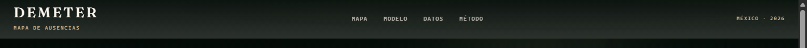

Encabezado oscuro, sin icono, sin “Datos abiertos” y sin botón “Abrir mapa”. La marca es tipográfica y el acento es dorado, en continuidad con el bosque y las mariposas del hero.

### 01 · Portada

Mensaje central: “Cada punto es una persona que alguien busca”. El expediente resume registros, entidades, municipios y corte.

### 02 · Mapa por personas

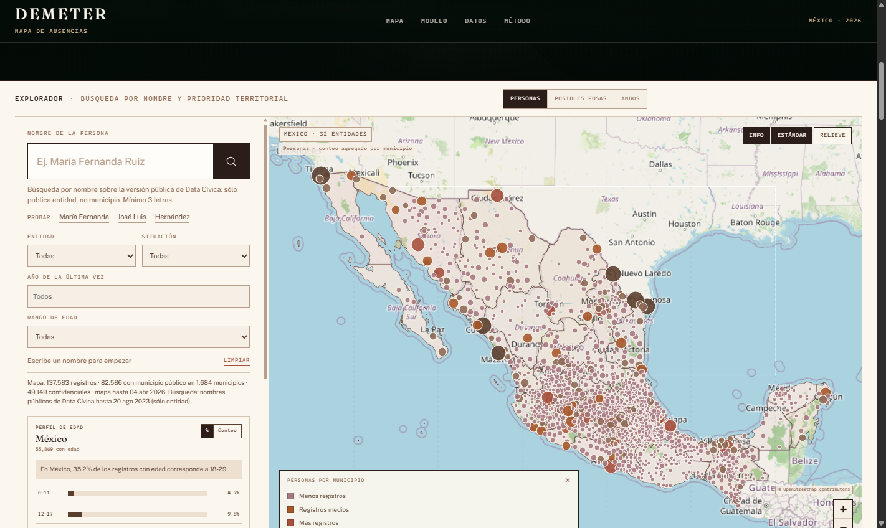

Cada círculo es un agregado municipal. El tamaño crece con el número de registros. No es una ubicación exacta.

### 03 · Prioridad municipal

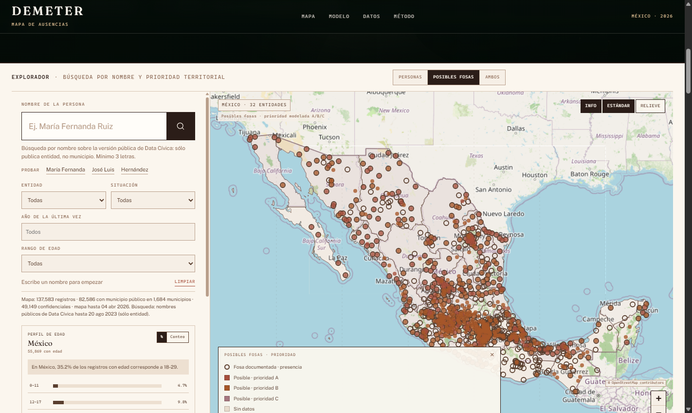

Puntos rellenos: prioridad del modelo. Anillos oscuros: presencia documentada. El mapa coloca el punto en el centroide del municipio, no en una fosa.

### 04 · Mapa limpio

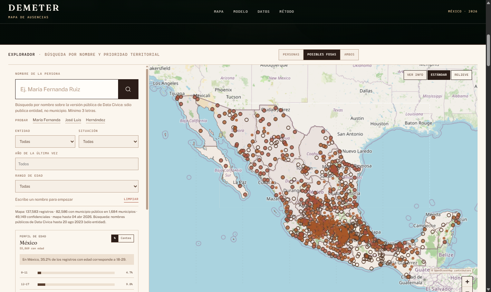

El botón **Info** oculta leyenda y subtítulo. El mapa queda limpio para explorar. El botón cambia a **Ver info**.

### 05 · Búsqueda por nombre

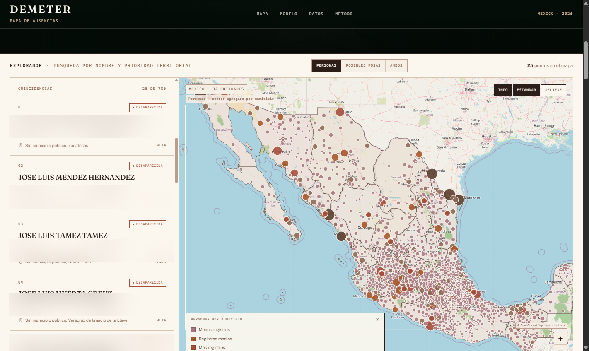

Búsqueda aproximada sobre nombres públicos. Los resultados muestran coincidencia, edad, última vez y precisión de ubicación. No hay municipio público en esta capa.

**Versión pública:** los nombres de las tarjetas están difuminados. No se distribuyen las capturas con nombres legibles.

### 06 · Ficha individual

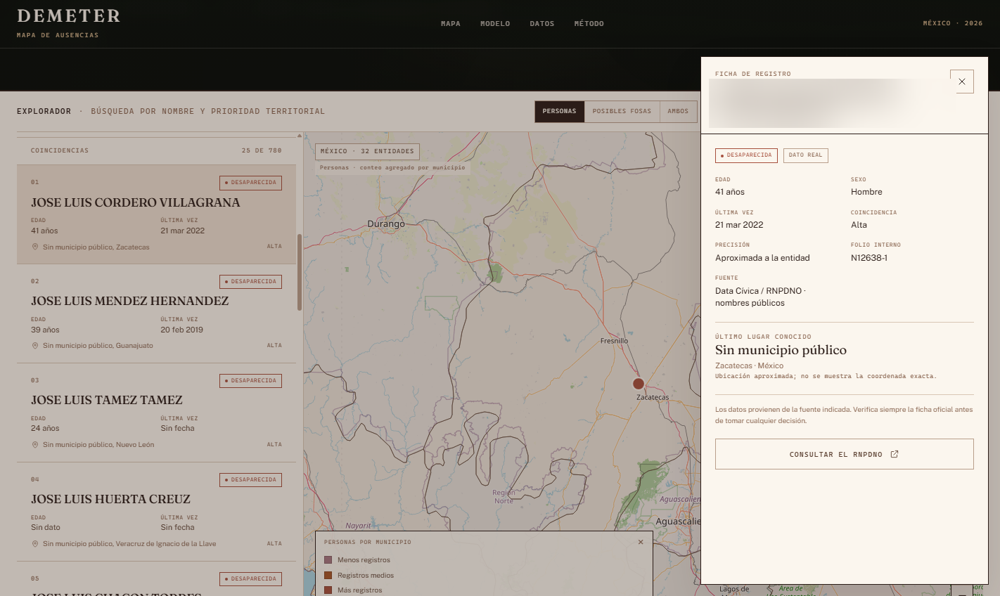

La ficha muestra edad, sexo, fecha, estatus, precisión y fuente. No muestra coordenadas numéricas. El botón final lleva a la consulta oficial.

**Versión pública:** el nombre está difuminado; el resto de la ficha conserva la estructura real.

### 07 · Modelo

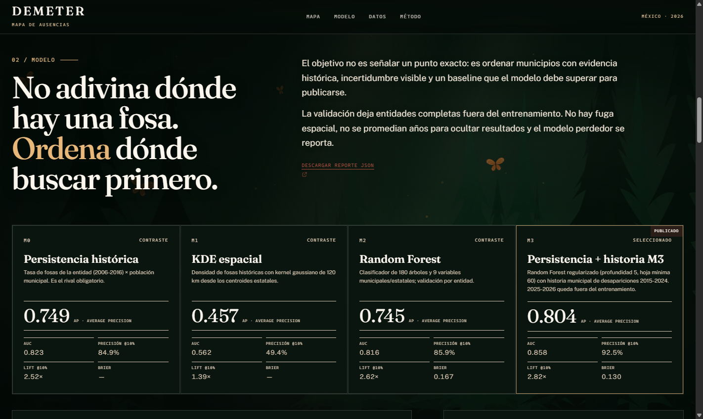

M0, M1, M2 y M3 con AP, AUC, precisión @10%, lift y Brier. M3 está seleccionado; M4 no se muestra porque está en sandbox.

### 08 · Datos y límites

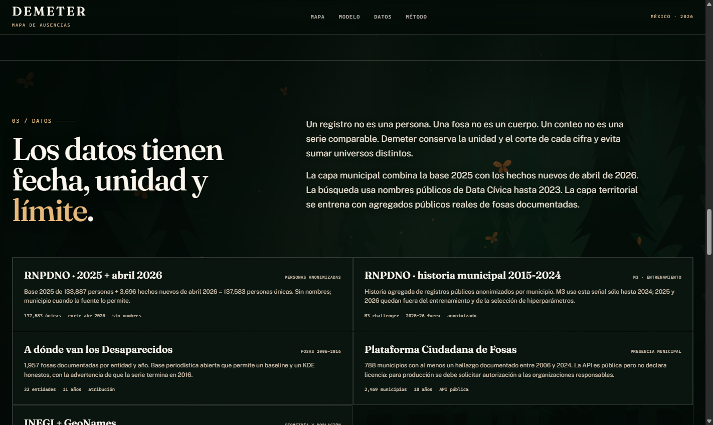

Fuentes, unidades, cortes y límites. El aviso del RRA 09082/20 y la evidencia pública de fosas están más abajo en la misma sección.

### 09 · Método

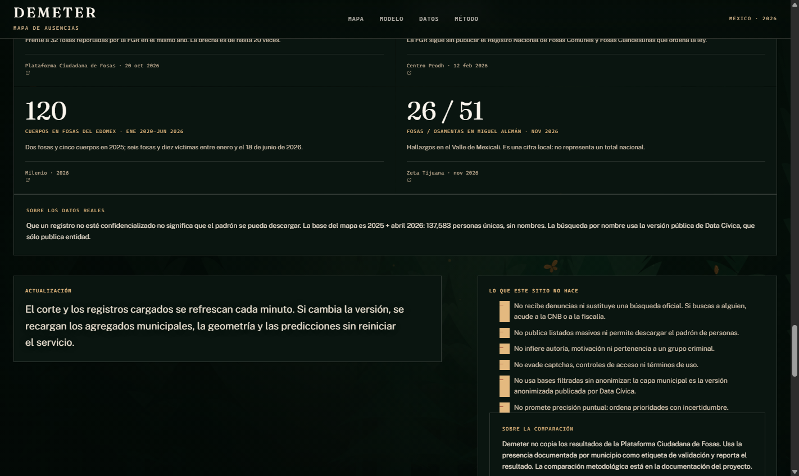

Normalización, indexado, validación espacial y ordenamiento. La tabla de complejidad y la lista de seguridad están en la misma sección.

### 10 · Móvil

Header reducido a marca y menú. El hero conserva jerarquía y legibilidad.

### 11 · Menú móvil

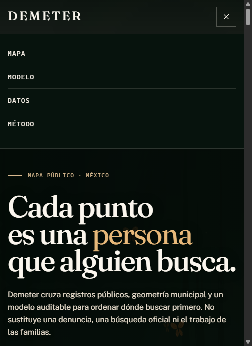

Navegación táctil sobre fondo oscuro, coherente con el header.

### 12 · Mapa móvil

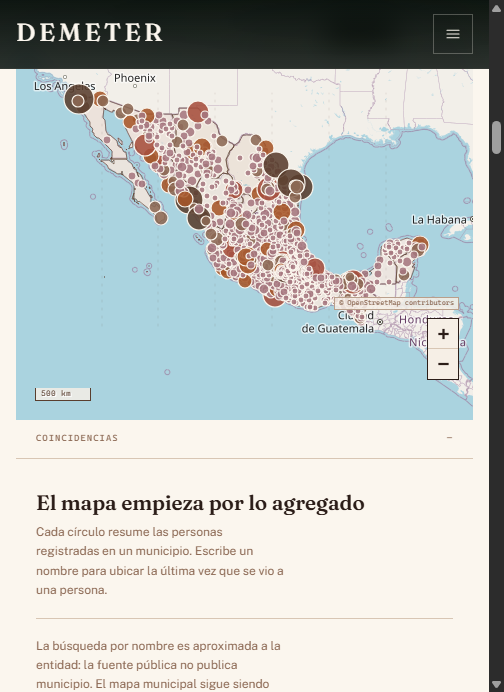

Mapa a ancho completo, información oculta por defecto y lectura vertical.

## Guion sugerido

1. **Abrir con el problema**, no con la tecnología: miles de personas siguen sin localizarse y la información está fragmentada.
2. **Mostrar la portada** y explicar que el mapa usa datos anonimizados.
3. **Entrar al mapa** y comparar “Personas” con “Posibles fosas”: una capa cuenta registros; la otra prioriza municipios.
4. **Ocultar la información** con el botón Info para demostrar que el mapa puede quedar limpio.
5. **Buscar un nombre** y abrir una ficha: mostrar que no se exponen coordenadas exactas.
6. **Ir al modelo**: explicar M0 como baseline, M3 como modelo publicado y M4 como sandbox.
7. **Cerrar con límites**: no es prueba de fosas nuevas, no sustituye a la fiscalía y la calibración local sigue pendiente.

## Antes de publicar las capturas

- Enmascarar nombres y cualquier dato identificable en 05 y 06.
- No presentar “Posibles fosas” como “fosas encontradas”.
- Añadir el aviso de que los puntos son municipios, no coordenadas.
- Revisar autorización de la fuente municipal de fosas.
- No afirmar que el modelo “predice” fosas nuevas.

## Estado técnico

- Aplicación: **http://localhost:8080**
- Registros: **137,583**
- Entidades: **32**
- Municipios: **2,469**
- Corte: **30 abr 2026**
- Modelo publicado: **M3**
- Pruebas: **27**
